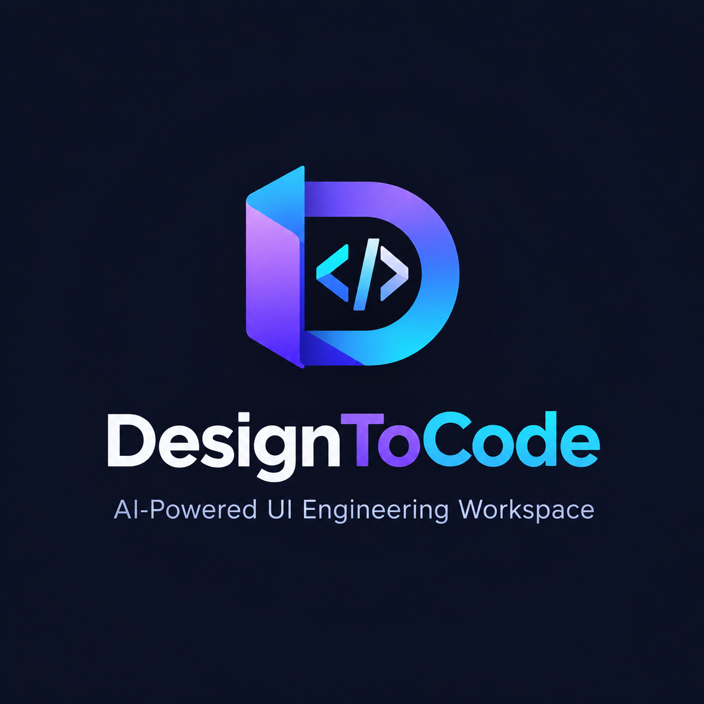

# DesignToCode

  

<h3 align="center">AI-Powered UXToolbox XML to Production-Ready WPF & MVVM Architecture Converter</h3>

  
  
  
  
  

  

---

## Project Overview

**DesignToCode** is a Windows desktop application built with **.NET 8 (WPF)**. It reads low-fidelity **UXToolbox 3.0 XML exports** and converts them into production-ready **WPF XAML Views** and clean **C# MVVM ViewModels** (`CommunityToolkit.Mvvm`).

Final Year Project – **COMSATS University Islamabad, Wah Campus** (Session 2023–2027)

| | |
|---|---|
| **Developed by** | Aroona Noor (SP23-BCS-015) · Maryam Arif (SP23-BCS-005) |
| **Supervised by** | Dr. Muhammad Khalil Afzal |

---

## Key Features

- **UXToolbox 3.0 XML Parser:** reads screens, sizes, orientation, colors and all controls; supports multi-screen designs.
- **WPF XAML Generation:** keeps the exact position, size, color and font of every control from the design.
- **MVVM ViewModel Generation:** creates ViewModels with `[ObservableProperty]` and `[RelayCommand]` using CommunityToolkit.Mvvm.
- **AI Enhancement (optional):** suggests meaningful control names, accessibility labels and command names through Microsoft Semantic Kernel (Groq / Gemini / OpenRouter / OpenAI). The AI never changes the layout.
- **Fallback Mode:** works fully offline without an API key, using fixed naming rules.
- **AI Comparison Table:** shows line by line what the AI changed compared to the no-key output.
- **Quality Analysis:** 23 static and 7 runtime rules (MVVM, accessibility, layout, naming) with a 0–100 score.
- **Live Preview:** preview the generated screens with zoom and resolution presets.
- **Export:** Visual Studio solution, ZIP archive, Git-ready folder or portable application, with a real build check.
- **History:** every conversion is saved in a local SQLite database.

---

## Download & Run

1. Go to the **[Latest Release](https://github.com/arifmaryam771/DesignToCode-App/releases/latest)** and download `DesignToCode-v1.0.zip`.
2. Right-click the ZIP → **Properties** → tick **Unblock** → **OK**.
3. Extract the ZIP to a folder (e.g. `C:\DesignToCode`).
4. Double-click **DesignToCode.exe**. The first start can take a few seconds.

### Requirements

| Item | Requirement |
|---|---|
| Operating system | Windows 10 (1809 or later) or Windows 11, 64-bit |
| .NET | Not needed (included in the app) |
| .NET 8 SDK | Optional, only for the Build / Export build check |
| AI API key | Optional (e.g. Groq). Without a key the app uses fallback mode |

### AI Setup (optional)

Open **Settings → AI Credentials & Engine**, choose a provider (e.g. **Groq**), paste your API key, click **Test Connection** and then **Save Settings**.

---

## 10-Stage Conversion Pipeline

| # | Stage | What happens |
|---|---|---|
| 1 | Input Check | Validate file existence and format |
| 2 | Validation | XML security (DTD prohibited) and parsing |
| 3 | Parsing | Build the Design AST and WPF control tree |
| 4 | AI Analysis | Semantic names via Semantic Kernel (optional) |
| 5 | XAML Generation | WPF XAML views |
| 6 | MVVM Generation | C# ViewModels with properties and commands |
| 7 | Build Verification | Real `dotnet build` of the generated project |
| 8 | Quality Analysis | WCAG, MVVM and layout rules |
| 9 | Live Preview | Render the generated screens |
| 10 | Export | Save the solution and history record |

---

## Technology Stack

| Layer | Technology |
|---|---|
| Core Framework | .NET 8.0 (C# 12, WPF) |
| MVVM Pattern | CommunityToolkit.Mvvm 8.2.2 |
| AI Layer | Microsoft Semantic Kernel 1.14.1 |
| Code Editors | AvalonEdit 6.3.0 & WPF-UI 3.0.5 |
| Code Analysis | Roslyn (Microsoft.CodeAnalysis.CSharp 4.8.0) |
| Database | SQLite + EF Core 8 |
| Logging | Serilog |
| Testing | xUnit & Moq |

---

© 2026 Aroona Noor & Maryam Arif · COMSATS University Islamabad, Wah Campus

